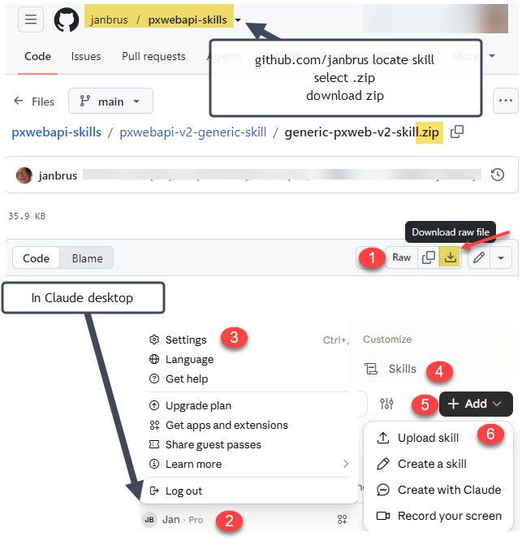
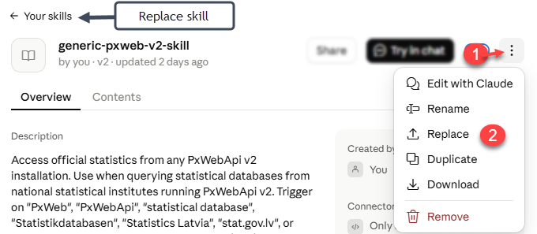

# Agent Skill: SCB PxWebApi v2 - BETA

En [Agent Skill](https://agentskills.io) — en `SKILL.md` med arbetsflöde och regler plus referensfiler. Den lär AI-verktyg som Claude och ChatGPT att söka, utforska och hämta data från SCB:s Statistikdatabas via PxWebApi v2. Formatet är en öppen standard som stöds av [Claude](https://support.claude.com/en/articles/12512180-use-skills-in-claude), [ChatGPT och Codex](https://developers.openai.com/codex/skills/) m.fl.

## Vad skillen gör

- Guidar AI-assistenten genom rätt arbetsflöde: sök → metadata → query → presentera
- Täcker alla endpoints i PxWebApi v2 (tabeller, metadata, kodlistor, sparade frågor, config)
- Hanterar kodlistor och aggregeringar
- Kräver att varje siffra är hämtad från API:et i samma konversation — aldrig ur minnet
- På svenska och engelska

## Filstruktur

```
scb-pxwebapi-v2/
├── SKILL.md                  # Huvudinstruktioner och arbetsflöde
├── README.md                 # Denna fil
├── CHANGELOG.md              # Ändringslogg — gällande version står i SKILL.md-frontmatter (metadata.version)
├── scb-pxwebapi-v2-skill.zip # Färdigpackad skill — ladda upp i Claude.ai, eller packa upp i .agents/skills/ för ChatGPT/Codex
├── references/
│   ├── json-stat2.md         # json-stat2 så som SCB levererar det: sju läsregler först, sedan fälten, obligatoriska noter på tre nivåer, status och länkar
│   ├── mcp-tools.md          # Mappning till @jarib/pxweb-mcp och verktygens begränsningar mot SCB
│   └── search-syntax.md      # Lucene-baserad söksyntax för /tables?query=
└── docs/                     # Tillägg: följer inte med i zip:en
    ├── skillkarta-arbetsflode.svg              # Diagram över arbetsflödet: Steg 1–6 och API-anropen i varje steg
    ├── skillkarta-kontroll-och-paketering.svg  # Diagram över vad som kontrolleras mot live-API:et och vad som packas
    └── skillkarta.html                         # Båda diagrammen med förklaring. Öppnas i webbläsare från ett klonat repo
```

`CLAUDE.md`, `DEVLOG.md`, `scripts/` och `evals/` i repot är underhållarinterna och ingår inte i paketet.

## Installation

### Claude.ai och Claude desktop

1. Ladda ner `scb-pxwebapi-v2-skill.zip`, eller bygg den själv från repot:

   ```bash
   scripts/build_zip.sh
   ```

   Paketet innehåller endast de användarvända filerna (`SKILL.md`, `README.md`, `CHANGELOG.md`, `references/`) plus `LICENSE` under toppmappen `scb-pxwebapi-v2/`.

2. Gå till **Settings > Skills** → **+ Add** → **Upload skill**
3. Välj ZIP-filen



Under **Settings > Capabilities** måste *Cloud code execution and file creation* vara på. Ska skillen hämta data själv, utan MCP-server, slår du också på *Allow network egress* och lägger till `*.scb.se` under *Additional allowed domains*. 

För att uppdatera laddar du ner den nya ZIP-filen, öppnar skillen under **Settings > Skills** och väljer **⋮** → **Replace**. 



### Claude Code

Packa upp ZIP-filen i skills-katalogen. Toppmappen har det installerade namnet `scb-pxwebapi-v2`; mappen i repot heter `scb-pxwebapi-v2-skill`:

```bash
unzip scb-pxwebapi-v2-skill.zip -d ~/.claude/skills/

# eller symlänka från roten av ett klonat repo, så håller git pull kopian aktuell
ln -s "$PWD/scb-pxwebapi-v2-skill" ~/.claude/skills/scb-pxwebapi-v2
```

### ChatGPT och Codex

ChatGPT och Codex läser skills i samma format från `~/.codex/skills/` för alla projekt (Windows: `%USERPROFILE%\.codex\skills\`) och från `.agents/skills/` för ett projekt (se [OpenAI:s dokumentation](https://developers.openai.com/codex/skills/)). Packa upp ZIP-filen där. Toppmappen `scb-pxwebapi-v2/` har det installerade namnet:

```bash
# Mac/Linux
unzip scb-pxwebapi-v2-skill.zip -d ~/.codex/skills/

# Windows (PowerShell)
Expand-Archive scb-pxwebapi-v2-skill.zip -DestinationPath $env:USERPROFILE\.codex\skills
```

ChatGPT:s `$skill-installer` hämtar mappar, inte ZIP-filer, och tar då med de repointerna filerna. Fristående skills finns i ChatGPT:s skrivbordsapp, Codex CLI och IDE-tillägget; på webb och mobil måste skillen paketeras som plugin.

## MCP-servrar

För att Claude eller ChatGPT faktiskt ska kunna *anropa* API:et behövs ett verktyg:

- **@jarib/pxweb-mcp** (https://www.npmjs.com/package/@jarib/pxweb-mcp) — open source, fungerar med PxWeb-installationer inklusive SCB. Måste startas med `--url https://statistikdatabasen.scb.se/api/v2` (standard är norska SSB) — se `references/mcp-tools.md`
- Egen MCP-server med FastMCP eller liknande
- Utan MCP räcker ett verktyg som kan göra HTTP GET och POST (t.ex. `curl` via Bash)

## Dokumentation

- **Handbok om att använda PxWebApi v2** — SCB hänvisar till PxTools-guiden (engelska): https://www.pxtools.net/PxWebApi/documentation/user-guide/. Exemplen där är SSB:s; gränser och format skiljer sig hos SCB (se `SKILL.md`)
- **OpenAPI, interaktiv** — https://statistikdatabasen.scb.se/api/v2/index.html
- **PxApiSpecs** (YAML, gemensam för PxWeb-miljön) — https://raw.githubusercontent.com/PxTools/PxApiSpecs/master/PxAPI-2.yml
- **Konverterare från v1 till v2** — https://pxapiconverter.scb.se/ översätter en v1-fråga mot `api.scb.se/OV0104/v1/doris/` (URL plus POST-body) till en v2-fråga, som GET-URL eller POST
- **Frågor om API:et** — px@scb.se

## Licens

Skillen (`SKILL.md`, `references/` och skripten) är licensierad under [MIT-licensen](https://github.com/janbrus/pxwebapi-skills/blob/main/LICENSE), © 2026 Jan Bruusgaard. Licenstexten ligger i repots rot och följer med i zip-filen som `LICENSE`. MIT gäller skillen, inte datat den hämtar — det har en egen licens, se nedan.

SCB:s statistik publiceras under Creative Commons CC0 1.0 (licens-URL:en finns i `GET /config`, fältet `license`). Skillen behåller ändå källhänvisning som god praxis.
